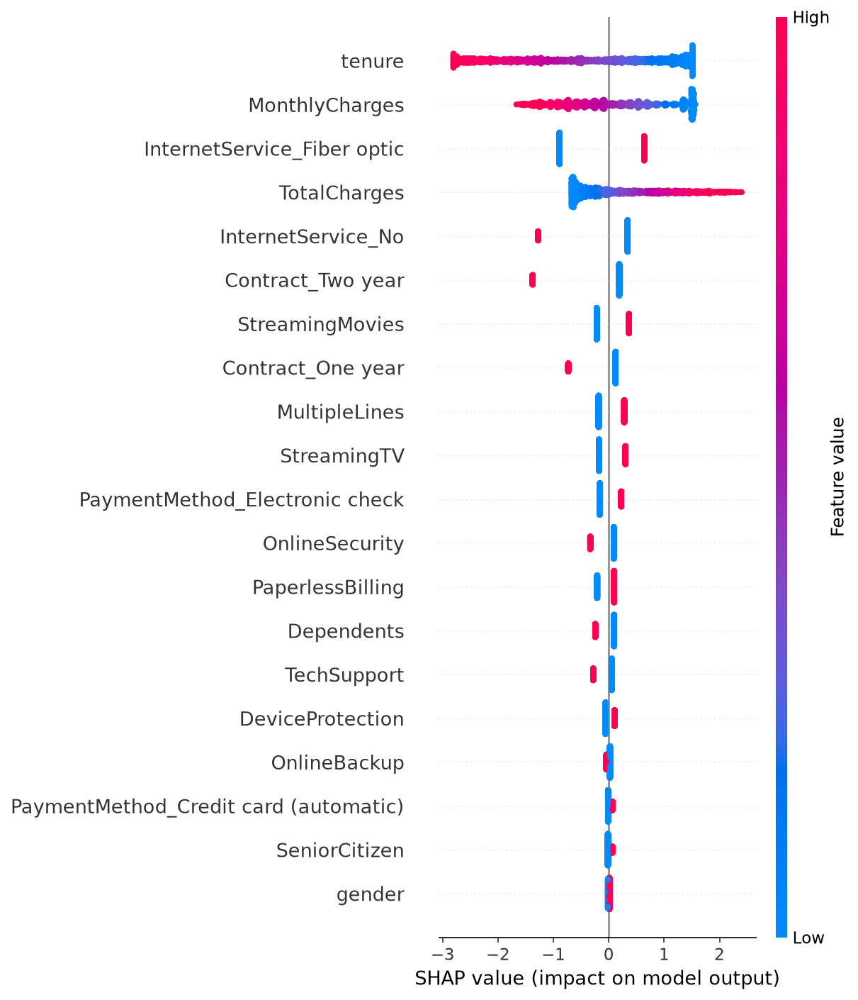
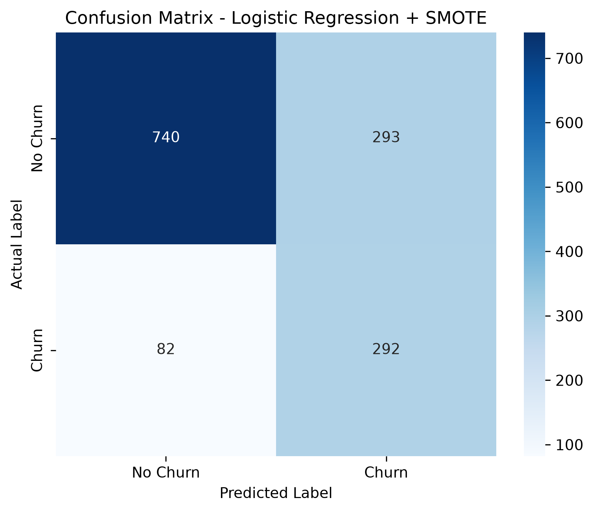

# Telecom Customer Churn Prediction

## Project Overview

Customer churn is a major challenge for telecommunications companies. This project uses machine learning to identify customers who are likely to discontinue their services.

The objective is to analyze customer data, build classification models, evaluate their performance, and understand the factors influencing customer churn.

## Dataset

- **Source:** [Telco Customer Churn Dataset](https://www.kaggle.com/datasets/blastchar/telco-customer-churn)
- **Records:** 7,043 customer records in the original dataset.
- **Target Variable:** `Churn`

The raw dataset is not included in this repository. Download it from the source and place it inside the `data/` directory.

## Project Structure

```text
telecom-churn-prediction/
├── data/
├── notebooks/
│   └── churn_analysis_cleaned.ipynb
├── images/
│   ├── confusion_matrix.png
│   └── shap_summary.png
├── .gitignore
├── requirements.txt
└── README.md
```

## Technologies Used

- Python
- Pandas
- NumPy
- Scikit-learn
- Imbalanced-learn (SMOTE)
- SHAP
- Matplotlib
- Seaborn

## Methodology

1. Data cleaning and preprocessing
2. Exploratory Data Analysis (EDA)
3. Feature encoding and preparation
4. Logistic Regression, Decision Tree, and Random Forest
5. Handling class imbalance using SMOTE
6. Cross-validation
7. Model explainability using SHAP

## Model Evaluation Results

| Model | ROC-AUC | Accuracy | Churn Precision | Churn Recall | Churn F1-score |
|---|---:|---:|---:|---:|---:|
| Logistic Regression | 0.8357 | 0.80 | 0.65 | 0.57 | 0.61 |
| Decision Tree | 0.8195 | 0.78 | 0.58 | 0.41 | 0.59 |
| Random Forest | 0.8215 | 0.79 | 0.62 | 0.49 | 0.55 |
| Logistic Regression + SMOTE | 0.8340 | 0.73 | 0.50 | 0.78 | 0.61 |

### Cross-Validation

Logistic Regression was evaluated using 5-fold cross-validation:

- **Mean ROC-AUC:** 0.8458
- **Standard Deviation:** 0.0055
- **Score Range:** 0.8391 – 0.8538

### Final Model Selection

Logistic Regression with SMOTE was selected as the final model because it achieved a churn recall of 0.78.

This means the model identified approximately 78% of the actual churn customers in the test set. However, this improvement came with lower precision (0.50) and accuracy (0.73).

The choice prioritizes identifying more potential churn customers rather than maximizing overall accuracy.

## Model Explainability (SHAP)

SHAP was used to understand how different features influence the model's predictions.



Key observations:

- Customer tenure plays an important role in churn predictions.
- Fiber optic internet service tends to push predictions toward churn.
- Longer contract durations tend to reduce predicted churn.
- Electronic check payment method tends to push predictions toward churn.
- Features such as OnlineSecurity and TechSupport can influence predictions away from churn.

These observations describe the model's learned patterns and do not establish causation.

## Confusion Matrix



## Limitations

- The dataset represents a specific telecommunications customer base and may not generalize to every company.
- SMOTE improves churn recall but also increases false-positive predictions.
- Model predictions indicate patterns and associations, not causal relationships.
- Further tuning and testing on additional datasets could improve model performance.

## How to Run

1. Clone this repository.
2. Download the dataset from the Kaggle source.
3. Place the CSV file inside the `data/` directory.
4. Install the dependencies:

```bash
pip install -r requirements.txt
```

5. Open the notebook:

```bash
jupyter notebook notebooks/churn_analysis_cleaned.ipynb
```